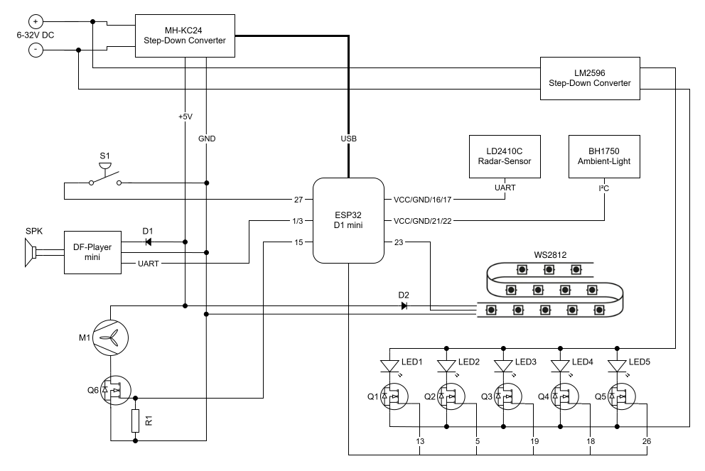
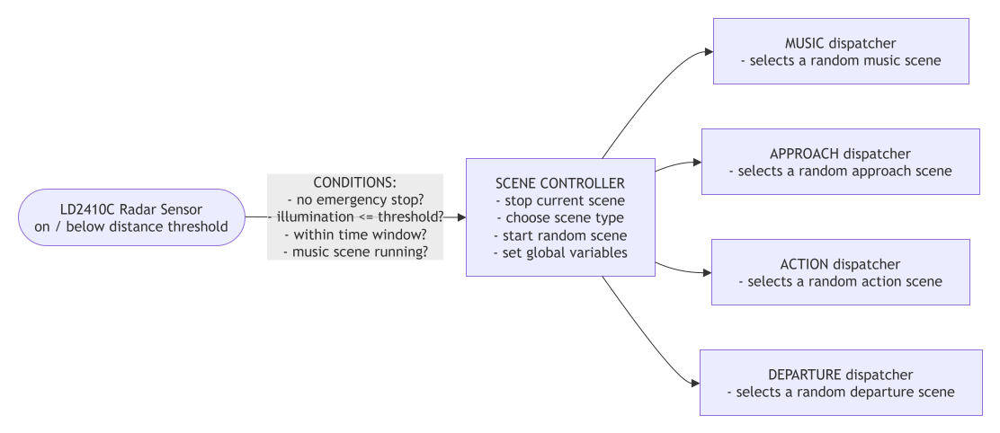

## Hardware

| Qty. | Part                        | Comment |
| ---- | --------------------------- | ------- |
| 1    | ESP32 D1 mini               | Controller |
| 1    | DFPlayer Mini               | Audio playback |
| 1    | Speaker                     |  |
| 1    | SD-Card                     | for the MP3s |
| 1    | LD2410C radar sensor        | Presence detection |
| 1    | BH1750 ambient light sensor | Ambient light measurement |
| 1    | WS2812 RGB LED strip        | RGB lighting |
| 5    | Power LEDs                  | Flash/thunder effect |
| 1    | Fan (5V)                    | fluttering curtains |
| 1    | Red buzzer [S1]             | emergency stop |
| 1    | MH-KC24 step-down converter | power supply (6-32V in / 5V 3A out) |
| 1    | LM2596 step-down converter  | power supply for Power-LEDs |
| 2    | Diode [D1-D2]               | reducing voltage to 4,3V |
| 6    | MOSFET (AO3400) [Q1-Q6]     | load switching |
| 1    | Resistor (470kΩ) [R1]       | pull-down |
|      | Wires                       |  |

## Pinout

| Pin    | Target       | Note               |
| ------ | ------------ | ------------------ |
| GPIO1  | DF-Player TX |                    |
| GPIO3  | DF-Player RX |                    |
| GPIO5  | Power-LED 2  | Flash/Thunder      |
| GPIO13 | Power-LED 1  | Flash/Thunder      |
| GPIO15 | 5V Fan       |                    |
| GPIO16 | LD2410C RX   | Radar-Sensor       |
| GPIO17 | LD2410C TX   | Radar-Sensor       |
| GPIO18 | Power-LED 4  | Flash/Thunder      |
| GPIO19 | Power-LED 3  | Flash/Thunder      |
| GPIO21 | BH1750 SDA   | Ambient Light      |
| GPIO22 | BH1750 SCL   | Ambient Light      |
| GPIO23 | WS2812 Data  | RGB LED-Strip      |
| GPIO26 | Power-LED 5  | Flash/Thunder      |
| GPIO27 | Red Buzzer   |                    |

> GPIO7-11 are not allowed to be used (SPI bus for flash memory)  
> GPIO34-36+39 are input only pins  
> GPIO1+3 must be used with care and can only be used with disable logging via UART

## Electrical Circuit

## Trigger 

